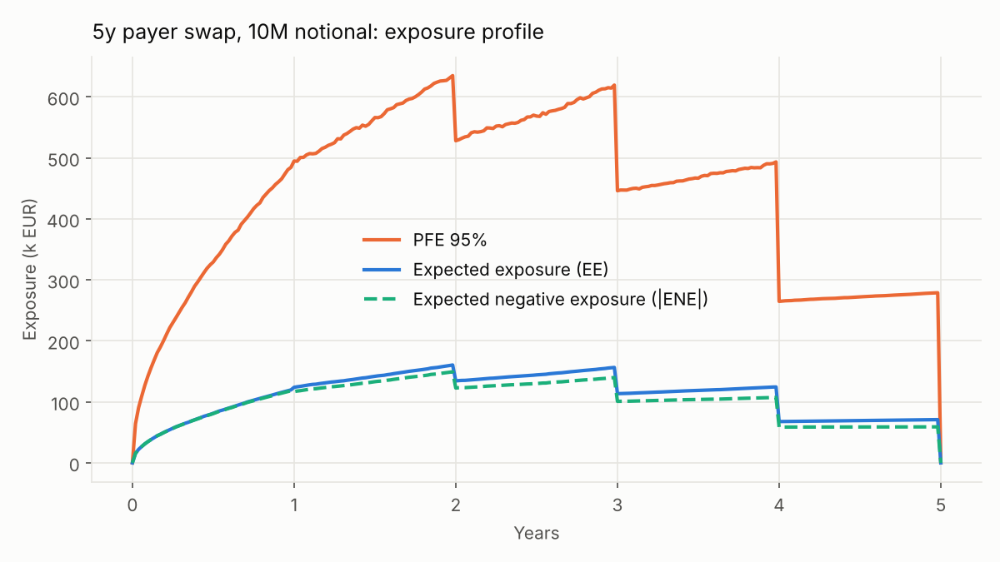
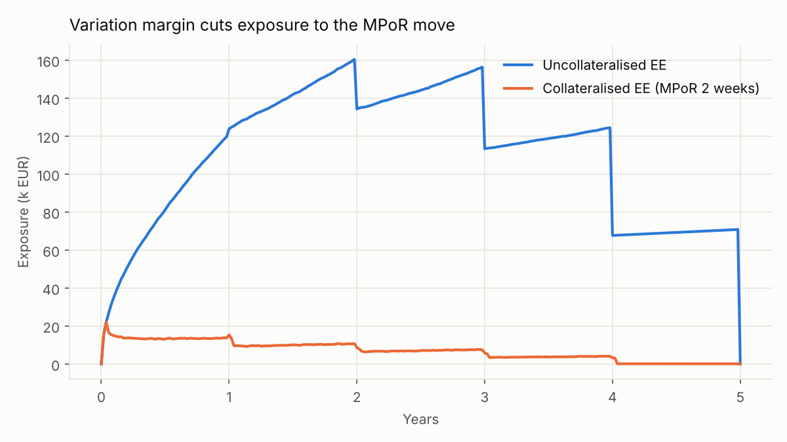
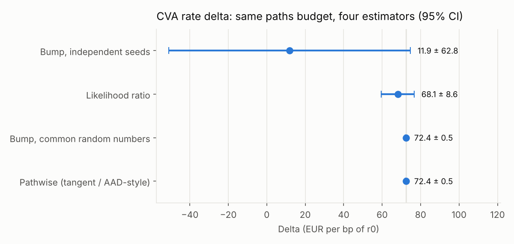
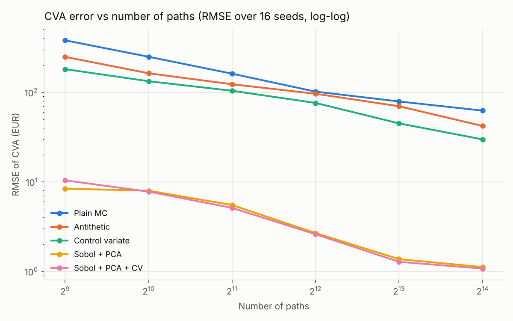

# CVA of an interest rate swap — exposures, Greeks and variance reduction

A compact, tested Monte Carlo engine for counterparty credit risk on a plain-vanilla
interest rate swap: simulated exposures, CVA / DVA, collateral, **CVA sensitivities
by four estimators**, and a **variance-reduction benchmark** (antithetic, control
variate, scrambled Sobol with PCA path construction).

## 1. Exposure and CVA

- **Rates**: one-factor Vasicek, exact Gaussian transition (no discretisation bias),
  20,000 antithetic paths, weekly grid over 5 years.
- **Trade**: 5-year payer swap, 10M notional, struck at par, revalued on every path
  and date with closed-form Vasicek bond prices.
- **Credit**: flat hazard rate from the CDS spread (credit triangle λ = s / (1 − R)).
- **Collateral**: variation margin with a 2-week margin period of risk (MPoR).

| Metric | Value |
|---|---|
| Par swap rate | 2.61% |
| Peak EE / Peak PFE 95% | 160k / 635k |
| EPE (1y) | 78k |
| **CVA, uncollateralised** (cpty CDS 150 bp, R = 40%) | **7.2k (≈ 7.2 bp of notional)** |
| DVA (own CDS 100 bp) / Bilateral CVA | 4.7k / 2.5k |
| **CVA, collateralised** (MPoR 2 weeks) | **0.5k (−93%)** |



The saw-tooth is the classic swap profile: exposure grows with rate uncertainty
(diffusion effect) and drops at each coupon as fewer cash flows remain (amortisation effect).



## 2. CVA Greeks: four estimators, same path budget

Rate delta of the CVA (sensitivity to r0), 32,768 paths each:

| Estimator | Delta (EUR/bp) | Std error | Efficiency vs pathwise* |
|---|---|---|---|
| Bump & revalue, independent seeds | 11.9 | 32.1 | 0.00004 |
| Likelihood ratio | 68.1 | 4.38 | 0.006 |
| Bump & revalue, common random numbers | 72.45 | 0.26 | 0.68 |
| **Pathwise, exact tangent (AAD-style)** | **72.45** | **0.26** | **1** |

\*Efficiency = 1 / (variance × CPU time), normalised.



- **Independent seeds**: the Monte Carlo noise of two separate runs swamps a 1 bp
  move — the estimate is meaningless. Variance is ~15,000× higher.
- **Common random numbers**: same normals for the up and down runs, the noise cancels.
- **Pathwise**: differentiate each path exactly. In Vasicek dr(t)/dr0 = e^(−at) and
  dP(t,T)/dr = −B(T−t)·P(t,T), so the swap's derivative is closed-form along the path;
  max(V,0) contributes the indicator 1{V>0}. One simulation gives the derivative,
  and with AAD this extends to hundreds of curve points at a few times the cost of one price.
- **Likelihood ratio**: differentiates the density, not the payoff (handles kinks and
  digitals) but its score scales like 1/(σ√Δt): unbiased, yet ~280× more variance here.

**CS01 = 45.0 EUR per bp of counterparty spread**, computed exactly: without wrong-way
risk the exposures do not depend on the spread, only the default probabilities move.

**Gamma** (EUR per bp²): the max(V,0) kink makes the second derivative ill-behaved.
Both the CRN second difference and the bumped pathwise delta give ≈ 0.74 at h = 1 bp,
but their standard error grows ~8× when h drops to 0.01 bp: the bump size is a
bias / variance trade-off. Production fixes: smoothing the max, or a pathwise–likelihood-ratio mix.

> Design note: the CVA sum uses the exposure at the end of each period. At inception
> a par swap has V(0) = 0 exactly, so a weight on max(V(0),0) would put a genuine kink
> in CVA(r0) and make the left and right deltas differ. Spotted while checking that
> pathwise and CRN deltas agree — they now match to 4 significant digits.

## 3. Variance reduction benchmark

RMSE of the CVA against a high-precision reference, 16 seeds per point:



| Paths | Plain MC | Antithetic | Control variate | Sobol + PCA |
|---|---|---|---|---|
| 512 | 381 | 249 | 182 | 8.4 |
| 16,384 | 62.5 | 42.1 | 29.8 | **1.1** |

- **Control variate**: X(t) = D(t)·V(t) has a closed-form mean (today's value of the
  cash flows still alive at t) and is strongly correlated with D(t)·V(t)⁺.
  Optimal β estimated per date. ~4× variance reduction.
- **Sobol + PCA**: scrambled Sobol points (unbiased, so error bars still exist) drive
  the eigenvectors of the rate covariance, ordered by variance. The first factor
  explains 75% of the path variance and the first three 91%, so the best-distributed
  Sobol coordinates go where they matter. **512 Sobol paths beat 16,384 plain MC paths;
  at equal paths the error is ~55× lower (~3,000× in variance).**
- Adding the control variate on top of Sobol + PCA brings nothing: once the
  integrand is this well sampled, the remaining error is not in the linear part.

## 4. Validation (`pytest`, 11 tests)

- MC zero-coupon price = Vasicek closed form; par swap worth 0 at inception
- Discounted swap value is a martingale before the first coupon (no-arbitrage)
- Payer and receiver values are exact mirrors; CVA = 0 without default risk
- Pathwise delta = CRN bump to 1e-3; likelihood ratio unbiased but noisier
- Analytic CS01 = bump; closed-form control-variate mean = simulation
- PCA factor reproduces the Vasicek covariance; Sobol + PCA agrees with plain MC

## 5. Limitations and next steps

- **No wrong-way risk**: credit and rates independent. Next: a CIR default intensity
  correlated with the short rate.
- **Vasicek, not calibrated**: next step is Hull-White fitted to the curve and swaption vols.
- **Single trade, simplified collateral**: no netting set, no MTA, no initial margin.
- **FVA, KVA, MVA** not covered.
- **Gamma**: smoothing of the max not implemented.

## Run it

```bash
pip install -r requirements.txt
python run.py            # exposures, CVA, DVA, collateral (seconds)
python run_advanced.py   # Greeks + convergence benchmark (~3 minutes)
python -m pytest -q
```

## Structure

```
src/vasicek.py             short-rate model: exact simulation, bond prices
src/swap.py                swap revaluation + exact pathwise derivative, discount factors,
                           closed-form E[D(t)V(t)]
src/exposure.py            EE, ENE, PFE, EPE, collateralised exposure
src/cva.py                 CVA weights, CVA, DVA, analytic CS01
src/greeks.py              delta: independent bump, CRN bump, pathwise, likelihood ratio; gamma
src/variance_reduction.py  antithetic, control variate, scrambled Sobol, PCA path construction
run.py / run_advanced.py   end-to-end results and figures
tests/                     validation
```
